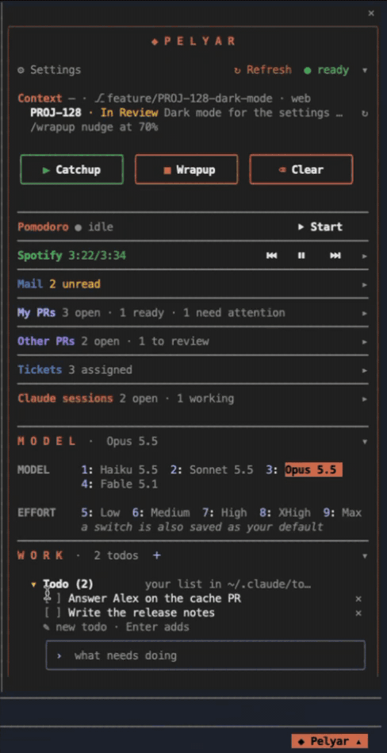
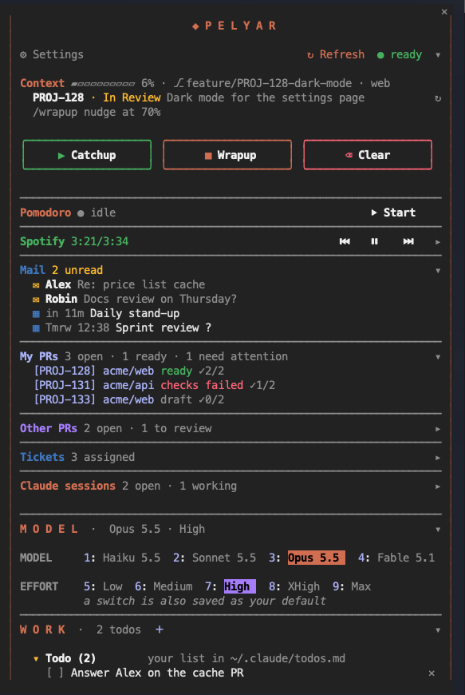

# Pelyar

**A harbour pilot for your Claude Code session.** A dashboard and control panel for
[Claude Code](https://claude.com/claude-code), docked beside the transcript.

<p align="center">
  
  &nbsp;&nbsp;
  
  <br>
  <sub>The panel with the made-up data of <code>PELYAR_DEMO=1</code>.</sub>
</p>

The name comes from the Croatian *peljar* (said "PEL-yar"): the harbour pilot who comes aboard and guides
a ship in, and the Adriatic pilot book sailors keep beside the wheel. The *y* spells it the way it sounds.

Pelyar does the same job for a Claude Code session. The model and effort, the context meter, your pull
requests, your tickets, a pomodoro and the music sit beside the conversation, so you don't have to leave
it to check them.

- **At a glance:** the context fill, the branch's ticket, your PRs and the ones waiting for your review,
  your tickets, unread mail and the next meeting.
- **One press away:** the model and effort, Catchup, Wrapup and Clear, a code review, your todo list.
- **Works with what you have:** GitHub, GitLab and Bitbucket; Jira, Linear, GitHub and GitLab issues.
  A source you don't have is left out quietly.
- **Sets itself up:** `/pelyar:setup` finds what this machine has and connects the rest with you.

## Try it in a minute

```
/plugin marketplace add mprtenjaca/pelyar
/plugin install pelyar@pelyar
```

To see the panel before anything is connected, start a session with made-up data:

```sh
PELYAR_DEMO=1 claude
```

Then `/pelyar`. The demo reads no server and none of your files, so it is also the safe way to take a
screenshot.

## What it shows

From the top:

- **Header**: the title (a press folds the dashboard), `⚙ Settings`, `↻ Refresh`, and `● ready` /
  `● working` while Claude answers.
- **Context**: the context fill meter with `⎇ branch · repo`, the ticket the branch name carries (a
  press opens it), and a nudge at 70% and 85%: `/wrapup` then `/clear` if the session has a wrapup
  command, `/compact` otherwise.
- **Catchup · Wrapup · Clear**: three framed buttons. Catchup and Wrapup run Pelyar's own skills
  (see [Wrap up instead of compacting](#wrap-up-instead-of-compacting)) or a command you name in the
  settings. Clear is built in.
- **Dashboard parts**. Each is one summary row, and a press unfolds it:
  - **Pomodoro**: 25/5, 45/15 or 50/10, with a macOS notification and a sound when a round ends. It keeps
    running across `/exit`.
  - **Spotify / Apple Music**: the track playing, with previous, play/pause and next (macOS, over
    `osascript`).
  - **My PRs** and **Other PRs**: your open pull requests and the ones you review, from **GitHub** (the
    `gh` CLI), **GitLab** (the `glab` CLI) and **Bitbucket Data Center** (an MCP server), side by side.
    Each PR shows its state: ready, waiting, draft, needs work, conflict, checks failed, open tasks,
    to review, re-review, approved.
  - **Tickets**: your open tickets from **Jira**, **Linear**, **GitHub issues** and **GitLab issues**, in
    one list.
  - **Mail**: unread mail and the next meetings, from an MCP server with the tools described under
    [Mail](#mail). Off by default.
  - **Claude sessions**: the other Claude Code windows on this machine, and whether each one is working.
- **Model**: Haiku, Sonnet, Opus, Fable, and Low to Max. A click runs `/model` or `/effort`, which also
  saves the choice as your default.
- **Work**: a todo list in `~/.claude/todos.md`, *Review changes* and *Review a PR* (`/code-review`),
  *Security review* (`/security-review`), and any command you pin with the ＋. If nothing fits, the same
  field can start a new skill with a `skill-creator` skill, when the session has one.
- **Team** (off by default): the skills of your team's plugin. See [Team skills](#team-skills).

Everything except Model and Work starts folded, and the folds are remembered across sessions. The panel
picks its light or dark shade from the terminal tab it runs in (Apple Terminal is asked for the tab's
profile, other terminals through `COLORFGBG`), or from the Theme row of `/config` otherwise.

Open it with `/pelyar` or with the button at the right of the prompt footer. In the fullscreen layout
(`/tui fullscreen`) it docks beside the transcript, otherwise it opens above the prompt. Esc closes it.
`/pelyar open`, `/pelyar close` and `/pelyar refresh` do what they say, and `/pelyar setup` runs the
setup (see [Setup](#setup)). Once the panel has the
focus (click on it, or ctrl+x tab), keys `1`-`4` pick the model and `5`-`9` the effort.

### Guards

- Pressing the model or effort that is already active only says so.
- One click at a time, and one command start at a time, so a double click runs a command once.
- Clear after a conversation, Wrapup, a second Catchup in the same conversation, and removing a todo all
  ask for a second press. It has to come at least half a second after the first and within 4 seconds,
  so a double click does not count as a confirmation.
- The todo list rejects an empty item, one longer than 200 characters, or one already on the list.
  Writes go through only if nobody else changed the file since it was read; otherwise the change is
  applied again to the new content.

### Wrap up instead of compacting

Auto-compact summarises the conversation to make room, and details and decisions get lost on the way.
Pelyar ships two skills for a different workflow:

1. `/pelyar:wrapup` saves where the session stands in the project's `CLAUDE.md`: the status of each
   story, the next step and recent decisions with their reasons. It archives finished stories, writes
   a record to `docs/records/` for a design or decision that needs more than a few lines, and commits
   `CLAUDE.md` when it is tracked in git.
2. `/clear` empties the conversation.
3. `/pelyar:catchup` in the next session reads the README, the recent commits, `CLAUDE.md`, the records
   the current work points to and the open notes in `docs/notes/*.open.md`, and sums up where things
   stand.

The Catchup and Wrapup buttons run these, and the context nudge suggests `/wrapup`. If you already use
other commands for this, name them in the *Catchup command* and *Wrapup command* settings. *Wrapup
commits* off makes Pelyar's wrapup write the files without committing them. The workflow follows
[claude-code-setup](https://github.com/b33eep/claude-code-setup) (MIT, archived since October 2026);
the skills are written anew for Pelyar.

## Install

From a local clone:

```sh
claude plugin marketplace add /path/to/pelyar
claude plugin install pelyar@pelyar
```

From GitHub:

```
/plugin marketplace add mprtenjaca/pelyar
/plugin install pelyar@pelyar
```

Then run `/reload-plugins`, or start a new session.

## Setup

**Run `/pelyar:setup`**, or ask Claude to set Pelyar up. The skill:

1. checks what this machine already has: `gh` and `glab` and their logins, and the MCP servers with
   the tools in the table below;
2. asks which parts you want;
3. walks you through connecting the missing sources. Logins run in a separate terminal window you
   open yourself, so Claude never sees a token;
4. switches the parts on or off in Pelyar's settings;
5. in auto mode, adds the allow rules for the MCP tools Pelyar reads.

Claude edits your settings only after showing you the change. Right after an install with nothing
connected, Claude offers the setup once, and the panel shows a *Set up* row until it has run (✕ hides
the row).

**For Claude:** the steps, the setting keys and the rule names are in
[`skills/setup/SKILL.md`](plugins/pelyar/skills/setup/SKILL.md). Follow it rather than this README.

Each part reads its own source, and a part whose source isn't set up says `not connected` quietly
instead of showing an error.

With the source settings on `auto` (the default), each source this machine has is read, and the rest
are left out without a word.

| Source | For | Needs |
|---|---|---|
| GitHub | PRs, issues | The [GitHub CLI](https://cli.github.com/), logged in: `gh auth login`. For GitHub Enterprise, log in to that host and set *GitHub host*. |
| GitLab | merge requests, issues | The [GitLab CLI](https://gitlab.com/gitlab-org/cli), logged in: `glab auth login`. For a self-managed GitLab, set *GitLab host*. |
| Bitbucket Data Center | PRs | An MCP server with the tool `bitbucket_getDashboardPullRequests`, such as the npm package [`@atlassian-dc-mcp/bitbucket`](https://www.npmjs.com/package/@atlassian-dc-mcp/bitbucket). |
| Jira | tickets | The Atlassian MCP server (`claude.ai Atlassian`, or your own with `searchJiraIssuesUsingJql` and `getAccessibleAtlassianResources`). |
| Linear | tickets | Linear's MCP server (`list_issues`, `get_issue`). Linear doesn't document the shape of its answers, so Pelyar reads them leniently. It hasn't been tried against the live server yet. |
| Mail | mail, meetings | See [Mail](#mail). |
| macOS | Spotify / Apple Music, the pomodoro notification | |

The panel finds each MCP tool on whichever connected server offers it, so the server's name doesn't
matter.

### The ticket row

The branch name points to its ticket in one of two ways:

- **A key**, such as `feature/PROJ-1234-tab-jump`. Pelyar asks Jira first, then Linear.
- **An issue number at the start of a segment**, such as `123-fix-login` or `feature/42-typo`. Pelyar
  asks GitHub or GitLab, whichever forge the checkout's `origin` is on.

### Permissions in auto mode

The panel's MCP reads pass the same permission check as Claude's own tool calls. In auto mode that check
judges a call against the prompt that asked for it. The panel's reads come from a timer, not from a
prompt, so without an allow rule each one is refused, and the panel says
`auto mode refused: allow the tool in /permissions`. Allow the read-only tools you use, in
`~/.claude/settings.json` or through `/permissions`:

```json
"permissions": {
  "allow": [
    "mcp__claude_ai_Atlassian__searchJiraIssuesUsingJql",
    "mcp__claude_ai_Atlassian__getAccessibleAtlassianResources",
    "mcp__claude_ai_Linear__list_issues",
    "mcp__claude_ai_Linear__get_issue",
    "mcp__<your-bitbucket-server>__bitbucket_getDashboardPullRequests"
  ]
}
```

The rule is `mcp__<server>__<tool>`, where `<server>` is the server's name with every character other
than a letter, digit, `-` or `_` replaced by `_`. None of these tools writes anything.

### Mail

Mail isn't a standard MCP tool, so the Mail part is off by default. It works with any MCP server that has
these two tools:

- `list_recent_emails` with `{ unread_only: true, count: 50 }`, answering
  `{ result: [{ id, from, from_name, subject }] }`, newest first;
- `list_calendar_events` with `{ days: 2, count: 20 }`, answering
  `{ events: [{ subject, start, end, is_all_day, show_as, response }] }`, with local times and no offset.

### Team skills

Off by default. When it's on, the Team section lists the skills of one plugin, `<prefix><team>`. The
team name comes from `git config user.team`, and the prefix from *Team plugin prefix* (`team-` by
default). With the prefix `team-` and `git config user.team "Platform Tools"`, it's the plugin
`team-platform-tools`, installed from any marketplace. In a repository without `user.team`, the panel uses
the name it read last. If no name is set at all and exactly one team plugin is installed, it takes that
plugin and says how to set the name. `? why is it missing` shows each step of the lookup.

## Settings

`/plugin configure pelyar@pelyar`, or `⚙ Settings` in the panel.

| Setting | Default | What it does |
|---|---|---|
| Panel title | empty | The title and footer button. Empty: "Pelyar". |
| Panel background | `none` | A palette for the whole panel (`slate`, `graphite`, `midnight`, `espresso`, `moss`), in its light shade on a light terminal. |
| Ticket row | on | The branch and the ticket its name carries ([The ticket row](#the-ticket-row)). |
| Context meter | on | The context fill and the nudge. |
| Pomodoro, Pomodoro length, Pomodoro sound | on, `25/5`, on | The timer, its rounds, and whether a round's end is heard. |
| Music player, Music app | on, `auto` | `auto` reads Spotify and Apple Music, and the one playing wins. |
| My PRs, Other PRs | on | Either one on reads the PR sources every five minutes. |
| PR sources | `auto` | `auto` reads every source this machine has. `github`, `gitlab` or `bitbucket` reads only that one, and says it when that source isn't set up. |
| GitHub host, GitLab host | empty | Empty for github.com, and for the host glab is logged in to. Otherwise a GitHub Enterprise or self-managed GitLab host. |
| Ticket list, Ticket sources | on, `auto` | `auto` reads Jira, Linear, GitHub and GitLab, whichever this machine has, or only the one named. |
| Jira site, Jira query | empty, empty | The site is `example.atlassian.net`. Empty means the first site the Atlassian server can reach. The query defaults to your open tickets, the latest first. |
| Mail and calendar | off | See [Mail](#mail). |
| Claude sessions | on | The other Claude Code windows on this machine. |
| Catchup, Wrapup, Clear / Model and effort / Todo list / Work commands | on | Each can be switched off. |
| Catchup command, Wrapup command | empty | The command each button runs. Empty: `/pelyar:catchup` and `/pelyar:wrapup`. |
| Wrapup commits | on | Whether `/pelyar:wrapup` commits `CLAUDE.md` and new records when `CLAUDE.md` is tracked. |
| Team skills, Team plugin prefix, Team marketplace | off, `team-`, empty | See [Team skills](#team-skills). The marketplace is only named in the install hint. |

A part that's switched off isn't read.

## Develop

```sh
claude plugin validate plugins/pelyar
claude plugin test plugins/pelyar
```

For a session that loads your working copy, use `claude --plugin-dir plugins/pelyar`. After editing,
run `/reload-plugins`. With `PELYAR_DEMO=1` every part shows the made-up data in `hooks/demo.ts`.

`skills/catchup` and `skills/wrapup` are the two session skills, and `skills/setup` sets Pelyar up. `hooks/register.tsx` holds every hook
and everything that talks to the engine. The engine follows `$` only within that file, and the state
atoms are declared there too. The other modules are plain code:

- `catalog.ts`: models and rows
- `settings.ts`
- `state.ts`: constants
- `todos.ts`, `ticket.ts`, `team.ts`: parsing and selection
- `terminal.ts`: the terminal's background
- the feeds: `pull-requests.ts` (Bitbucket, GitHub), `gitlab.ts`, `issues.ts` (GitHub, GitLab, Linear,
  the branch's issue), `jira.ts`, `mail.ts`, `pomodoro.ts`, `sessions.ts`, `spotify.ts`
- `util.ts`

See [CONTRIBUTING.md](CONTRIBUTING.md) for how to change it.

## License

MIT
